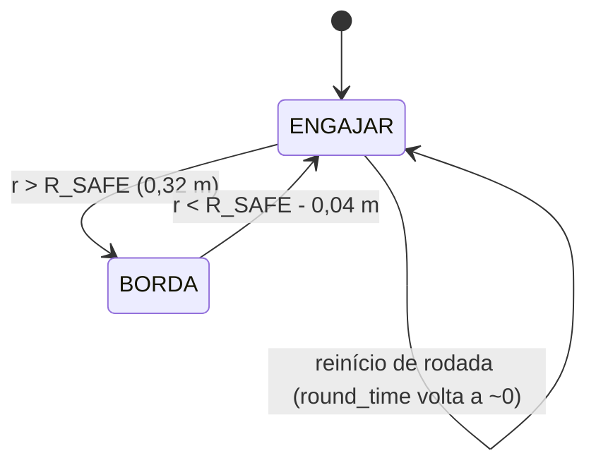
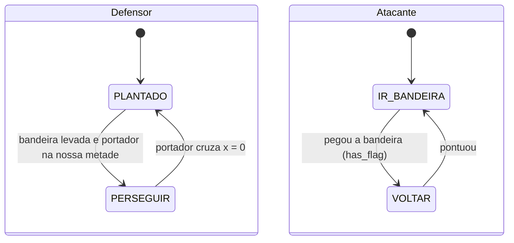
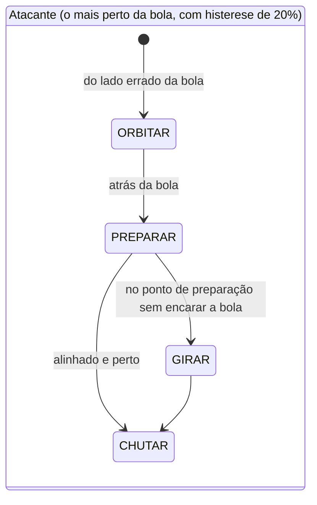

# Projeto final: sumô, rouba-bandeira e futebol (RASCUNHO)

RTech Tabajara, Projeto de Sistemas Robóticos (DCC/UFMG), 2º semestre de 2026.
Equipe: Lean Henrique Pereira Miranda, Guilherme Novais de Souza, Marcus Oliveira, Luis Eduardo, Hector Julio Pardinho Soares.

> **Estado deste rascunho (23/11/2026, após a Fase 3).** Só há números medidos nos nossos testes. Tudo o que depende de
> experimento ainda não feito está marcado com `[PREENCHER]` ou descrito como hipótese. As decisões, uma a uma, com
> evidência, estão em [`DECISOES.md`](DECISOES.md). **Todos os resultados de partida abaixo vêm de uma única execução
> de 60 a 120 s**, sem repetição.

---

## 1. Introdução e método

Cada jogo tem um arquivo (`sumo.py`, `ctf.py`, `soccer.py`) que roda como nó ROS no simulador do kit. O método foi:

1. **Ler o código do juiz e da física** do simulador (`world.py`, `scenarios/*.py`) para saber as regras exatas
   (por exemplo, que a força de cada robô é limitada a 0,20 N **por eixo do mundo**, e que no CTF o raio de segurar,
   0,10 m, é maior que o de pegar a bandeira, 0,07 m).
2. **Medir** o que dava para medir antes de construir em cima (Seção 4).
3. **Construir uma v1 funcional** dos três jogos, com robustez primeiro (publicar `(0, 0)` desde o primeiro ciclo,
   nunca morrer por exceção, detectar reinício de rodada).
4. **Testar contra sparrings**, inclusive réplicas dos adversários reais descritos pela observação da liga.
5. **Acompanhar a liga contínua** e registrar cada decisão.

A nota da competição avalia se os códigos **funcionam**, não a colocação; por isso a robustez veio antes da estratégia.

## 2. Interface e regras do arquivo

Cada arquivo é autossuficiente (só biblioteca padrão, `numpy`, `rospy`, mensagens do ROS e `psr_hero.utils`), não lê nem
grava arquivos, usa o mesmo código nos dois lados (o lado vem de `~robot`, `~team`, `~role`, `~opponent`) e publica só no
`cmd_vel` do próprio time. Limites do robô: `|v| ≤ 0,2 m/s` e `|w| ≤ 4 rad/s`; sem comando por 0,5 s o robô para.
O verificador do professor (`projeto-final/verificar.py`) passa nos três arquivos.

Controlador base ("ir até um ponto"), copiado em cada arquivo:

```
err = wrap(atan2(dy, dx) - yaw)        w = clamp(Kw * err)        v = V_MAX * max(0, cos err) * min(1, dist / D_SLOW)
```

com `Kw = 5` e, quando permitido, **ré** se `|err| > 90°` (inverte o heading-alvo e usa `v < 0`).

## 3. Os jogos (versão v1)

### 3.1 Sumô

**Ideia central.** Encarar o adversário e empurrar de frente, com a **borda sempre em primeiro lugar**: nunca perder sozinho.



- `ENGAJAR`: aponta para o adversário e anda à velocidade máxima (`D_SLOW` desligado).
- `BORDA`: vai ao centro com ré se preciso, sem virar as costas ao adversário.

| Constante | Valor | Origem |
|---|---|---|
| `R_SAFE` | 0,32 m | frenagem a 0,2 m/s consome ~3,8 cm (E3) e a perda é com o centro além de 0,40 m |
| histerese da `BORDA` | 0,04 m | evita oscilar na fronteira |
| `Kw` | 5 | controlador base |

**Por que essa estratégia.** Contra um adversário que encara e empurra, o resultado é empate (H1, medida em E2). O ganho
vem de não perder e de aproveitar quem erra ou fica parado. A liga confirma: o Tech lidera o sumô com 10V 17E 1D.

### 3.2 Rouba-bandeira

**Ideia central.** Um **defensor plantado** sobre a própria bandeira (o raio de segurar é maior que o de pegar) e um
**atacante** que vai à bandeira inimiga desviando dos oponentes.



| Constante | Valor | Para quê |
|---|---|---|
| `HOME_TOL` | 0,012 m | tolerância de "estou sobre a bandeira" (ganho de posição ~17 s⁻¹) |
| `FLAG_MOVED` | 0,05 m | bandeira própria a mais disso da base = foi levada |
| `R_REP`, `REP_GAIN` | 0,22 m, 2,0 | repulsão dos oponentes (maior que o raio de segurar, 0,10) |
| `T_STUCK`, `STUCK_BACK` | 1,5 s, 0,4 s | detector de travamento: ré curta com giro |

O defensor, já sobre a bandeira, **gira para encarar** o intruso mais perto dela. O atacante também usa um detector de
travamento (comando alto e robô parado por mais de 1,5 s).

### 3.3 Futebol

**Ideia central.** Goleiro na linha, **um atacante** que leva a bola ao gol e um apoio recuado.



| Constante | Valor | Para quê |
|---|---|---|
| `KEEPER_X`, `KEEPER_Y` | 0,80 m, 0,16 m | linha do goleiro e limite lateral (o gol vai até 0,20) |
| `PREP` | 0,12 m | ponto de preparação atrás da bola |
| `ALIGN_ERR`, `ALIGN_LAT` | 0,26 rad, 0,02 m | tolerâncias para chutar |
| `SWITCH_GAIN` | 0,8 | um novo atacante só assume se for ≥ 20% mais rápido |
| `CLEAR_DEPTH`, `GK_CLEAR_DEPTH` | 0,74 m, 0,78 m | bola funda na nossa área: limpar de lado; o goleiro também disputa |
| `R_ORB`, `ORB_STEP` | 0,16 m, 0,8 rad | órbita ao redor da bola (o robô nunca fica parado) |

Perto do nosso fundo o atacante **limpa a bola de lado** em vez de ir ao gol, porque ficar atrás dela exigiria estar
fora do campo e empurrá-la para o nosso gol é arriscado.

## 4. Experimentos de física (Fase 1)

Montagem: nós `exp_*.py` no kit; dados em `exercicios/registros/fase1/`. Análise: `exercicios/tools/fase1_analise.py`.

| Exp. | O que mediu | Resultado |
|---|---|---|
| **E3** frenagem | distância até parar | **3,76 cm** a 0,20 m/s (3,50 a 3,89) e **1,57 cm** a 0,10 m/s; parada em ~0,45 s. O excesso sobre a física pura (~1,5 cm) equivale a ~115 ms de latência (dedução) |
| **E1 frontal** | par em contato (adversário parado) | **0,099 m/s**, igual à média das velocidades-alvo; o parado cai em **6 de 6** rodadas, em ~2,25 s |
| **E1 lateral** | idem, empurrando pelo lado | **0,04 m/s**; o adversário caiu em **0 de 6** e o atacante em **6 de 6** (escorrega pelo flanco e sai primeiro) |
| **E2** inclinação | atacante inclinado contra o "facer", 10 rodadas por ângulo | φ = 0°: **10 empates**, deslocamento lateral 0,4 cm. φ = 35°: **10 empates**, 4,0 cm em ~43 s |

**Conclusões.** (i) Empurrão frontal contra quem também empurra empata (H1 confirmada). (ii) Inclinar o heading **não**
ajuda contra quem encara (H2 não confirmada): o adversário gira e continua empurrando de frente. (iii) O empurrão lateral
puro é instável. (iv) A margem da borda precisa contar ~4 cm só de frenagem.
**Limites:** só φ = 0° e 35° foram medidos (20° e 50° ficaram pendentes); o "facer" é uma réplica nossa; E4 (taxa de
pegada no CTF) e E5 (chute no futebol) **não foram feitos**. [PREENCHER: E4, E5 e φ = 20° e 50°]

## 5. Resultados das partidas (v1)

Todas as partidas abaixo são **uma execução** de 60 a 120 s no simulador; "parado" é um adversário sem nó.

### 5.1 Contra adversário parado, nos dois lados

| Jogo | Lado | Resultado | Erros |
|---|---|---|---|
| Sumô | `hero_0` | +19 vitórias, 0 derrotas (120 s) | 0 |
| Sumô | `hero_1` | +19 vitórias, 0 derrotas (120 s) | 0 |
| CTF | azul | 9 a 0 (124 s) | 0 |
| CTF | vermelho | 9 a 0 (112 s) | 0 |
| Futebol | azul | +7 gols, 0 sofridos (113 s) | 0 |
| Futebol | vermelho | +6 gols, 0 sofridos (113 s) | 0 |

### 5.2 Contra a própria v1 e contra os sparrings

| Jogo | Adversário | Resultado |
|---|---|---|
| Sumô | v1 | 3 empates por tempo (120 s) |
| Sumô | `sumo_facer` | 2 empates (60 s) |
| Sumô | `sumo_dodger` (desvia na largada) | **1 vitória e 2 derrotas** em 3 rodadas |
| Sumô | `sumo_tech` (réplica do Tech) | 2 empates (100 s) |
| CTF | v1 | sem pontos (120 s) |
| CTF | `ctf_tech` (réplica do ciclo de imunidade) | 0 a 0 (100 s); a réplica chegou a levar a nossa bandeira |
| CTF | `ctf_camper` | 0 a 0 (60 s) |
| Futebol | v1 | 0 a 0 (120 s) |
| Futebol | `soccer_nyx` (goleiro + dupla, como observado) | 0 a 0 (110 s) |
| Futebol | `soccer_swarm` | 0 a 0 (57 s) |

Contra os adversários descritos pela observação da liga (Tech no sumô, Nyx no futebol), a v1 **empata**, o que vale 1
ponto por partida. [PREENCHER: resultados da liga contra Tech, Nyx e Claude, com prints e data]

## 5b. Versão v2 (Fase 4)

Três correções, cada uma ligada a uma evidência (detalhes em `DECISOES.md`):

| Jogo | Mudança | Antes → depois (uma execução cada, simulador limpo) |
|---|---|---|
| Sumô | `BORDA` só sem contato; em contato mantém o empurrão | contra `sumo_dodger`: 5V 3D 4E em 12 rodadas → **31V 0D** em 31; contra `sumo_tech`: empates nos dois lados (igual) |
| Rouba-bandeira | atacante usa `held` e a imunidade de 1,5 s para ir direto; foge de ré com a bandeira | contra `ctf_tech`: 0 a 0 → **2 a 0** nos dois lados, 0 sofridos |
| Futebol | apoio acompanha o atacante ou cobre o gol; goleiro prevê onde a bola cruza a linha | contra `soccer_nyx` e `soccer_swarm`: 0 a 0 → 0 a 0 (sem piora nem ganho) |

**Causa das derrotas da v1 no sumô.** Com as forças saturadas e opostas, a força líquida é zero e o par mantém a velocidade
que tem. Quando o par chegava à borda do adversário, a nossa `BORDA` mandava recuar: largava o empurrão e o adversário nos
levava até o nosso lado. Foi achado gravando as posições a 10 Hz (12 rodadas) e olhando os 2 s antes de cada queda.
**Limite:** o `sumo_dodger` tem o mesmo defeito da v1, então o 31 a 0 não prova vitória contra o Tech real.

**Método.** Duas "regressões" que apareceram nos testes (futebol e CTF contra parado) eram contaminação: o time parado fica onde
o jogo anterior o deixou. Passamos a reiniciar o simulador antes de cada partida de teste.

## 6. Falhas observadas

- **Futebol, atacante parado para sempre (corrigido).** Em partida real o time vermelho ficou imóvel por 70 s. Causa:
  o ponto de preparação cortado pela parede coincidia com a posição do robô e `go_to` devolveu `(0, 0)` em cima do alvo.
  Um **teste de propriedade em malha fechada** (300 configurações aleatórias de bola e robô) achou ainda dois casos do mesmo
  tipo: chegar ao ponto de preparação sem encarar a bola e ter a bola encostada na parede. De 123 configurações paradas
  caiu a 0. Também: a bola parada atrás do nosso goleiro exigiu que o goleiro entrasse na disputa.
- **Sumô, v1 perdeu 2 de 3 rodadas para o `dodger`.** Em uma observação posterior da largada, o contato foi frontal e o par
  ficou em empate, então a causa das derrotas **não está esclarecida**. [PREENCHER: mais rodadas e a causa]
- **CTF, a v1 não fura um defensor plantado** (0 a 0 contra `ctf_camper`).
- **Infraestrutura (não do robô):** a janela do simulador no WSL2/Docker Desktop e um socket travado do Docker foram
  resolvidos fora do código dos jogos.

## 7. Repositório e reprodução

`projeto-final/` (arquivos do torneio), `exercicios/` (desenvolvimento, sparrings, ferramentas e registros),
`tools/sync.sh` (copia de `exercicios/` para `projeto-final/` e roda o verificador), `tests/` (63 testes offline).
[PREENCHER: instruções de cada confronto e links dos vídeos]
